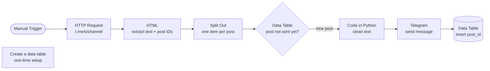

# 📰 News with Telegram Bot (n8n)

An [n8n](https://n8n.io) workflow that reads the latest posts from a **public Telegram channel**, cleans up their text, and reposts **only new posts** to your own Telegram channel through a bot. An n8n **Data Table** keeps track of the posts that were already sent, so nothing is published twice.

No Telegram API scraping library or user account is needed. The workflow reads the channel's public web preview (`https://t.me/s/<channel>`).

---

## ✨ Features

- **No-login scraping** — fetches posts from the public web preview of any open Telegram channel.
- **Pagination** — fetches more than one page of posts per run (2 pages by default, with a 1-second delay between requests).
- **Duplicate protection** — stores each sent post ID in an n8n Data Table and skips posts that already exist there.
- **Text cleanup (Python)**
  - Removes search tags such as `[?q=...]` and raw link brackets such as `[http...]`.
  - Converts Markdown links `[text](url)` to plain text.
  - Collapses extra spaces and blank lines.
  - Escapes `&`, `<` and `>` so the message is safe for Telegram's HTML parse mode.
- **Clean reposting** — sends the text through a Telegram bot without the n8n attribution footer.

---

## 🔄 Workflow Overview



| # | Node | Type | Purpose |
|---|------|------|---------|
| 1 | When clicking ‘Execute workflow’ | Manual Trigger | Starts the run |
| 2 | HTTP Request | HTTP Request | Downloads the channel's public web page, with pagination |
| 3 | HTML | HTML Extract | Extracts post text (`.tgme_widget_message_text`) and post IDs (`data-post`) |
| 4 | Split Out | Split Out | Turns the arrays into one item per post |
| 5 | If row does not exist | Data Table | Passes only posts whose `post_id` is not stored yet |
| 6 | Code in Python | Code (Python) | Cleans and HTML-escapes the post text |
| 7 | Send a text message | Telegram | Publishes the post to your channel |
| 8 | Insert row | Data Table | Saves the `post_id` so the post is not sent again |
| — | Create a data table | Data Table | One-time setup node that creates the `news_dt` table |

---

## 🚀 Getting Started

### Prerequisites

- An n8n instance with **Data Tables** and **Python Code node** support (a recent n8n version)
- A Telegram bot token from [@BotFather](https://t.me/BotFather)
- A Telegram channel where the bot is added as an **admin** with permission to post

### Installation

1. Clone this repository:
   ```bash
   git clone https://github.com/<your-username>/<repo-name>.git
   ```
2. In n8n, go to **Workflows → Import from File** and select `News_with_Telegram_Bot.json`.
3. Create a **Telegram API** credential in n8n using your bot token, and select it in the **Send a text message** node.
4. **Create the Data Table** (one time only): run the **Create a data table** node on its own. It creates a table named `news_dt` with a numeric `post_id` column.
5. Select that same table in both the **If row does not exist** and **Insert row** nodes.
6. Set your source and destination channels (see Configuration below).
7. Click **Execute workflow**.

---

## ⚙️ Configuration

| Setting | Node | Default | Change to |
|---|---|---|---|
| Source channel | HTTP Request → URL | `https://t.me/s/mtqdmon` | `https://t.me/s/<source_channel>` |
| Destination channel | Send a text message → Chat ID | `@test_news_channel_with_aya` | `@<your_channel>` or a numeric chat ID |
| Pages per run | HTTP Request → Pagination | 2 pages, 1 s interval | Any number you need |
| Data Table | If row does not exist / Insert row | `news_dt` | Your own table |

**Run automatically:** replace the Manual Trigger with a **Schedule Trigger** (for example every 10 minutes) and activate the workflow to get a live news feed.

---

## ⚠️ Known Limitations

- Only **public** channels work, because the workflow reads the `t.me/s/` web preview.
- Only the **text** of each post is reposted. Photos, videos and files are not copied.
- Post text and post IDs are extracted as two separate lists and then paired by position. Posts with no text (media only) can make the two lists different lengths, so some texts may be paired with the wrong ID.
- Telegram limits a text message to 4096 characters; longer posts will fail to send.
- If Telegram changes the HTML of its web preview, the CSS selectors in the **HTML** node must be updated.

---

## 🔒 Security Notes

- Credentials are **not** included in the exported JSON; you must create your own Telegram credential in n8n.
- Respect the source channel's terms and copyright. Get permission before republishing someone else's content.

---

## 🧰 Tech Stack

- **n8n** — workflow automation
- **Telegram Bot API** — publishing
- **n8n Data Tables** — duplicate tracking
- **Python** (n8n Code node) — text cleanup

---
